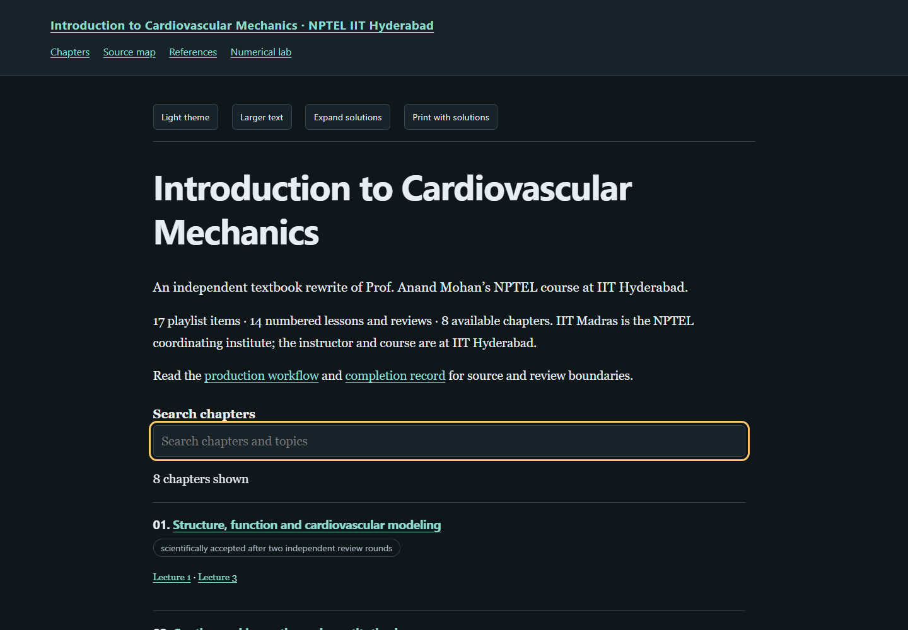

# Introduction to Cardiovascular Mechanics

An independent mathematical study edition of Prof. Anand Mohan's NPTEL course at **IIT Hyderabad**. IIT Madras coordinates NPTEL.

[Read the book](https://az9713.github.io/nptel-cardiovascular-mechanics-iith-notes/) · [Source map](source-map.html) · [Primary references](references.html) · [Numerical laboratory](numerical-lab.html)

Eight chapters contain 68 fully worked solutions, original derivations and figures, and eight executable chapter listings. The separate interactive laboratory has a ninth runnable example and a reusable Python calculation module. All eight chapters have completed two independent scientific review rounds, including required repairs. Current release status is recorded in [completion.json](completion.json) and the validation records below.

| Chapter | Subject | Recurring mathematical question |
|---|---|---|
| 1 | Structure, function and modeling | How do flow constraints change oxygen delivery? |
| 2 | Continuum kinematics and constitutive laws | Which deformations are strain, and which are rotation? |
| 3 | The heart as a cyclic pump | How do valves, storage and loading determine delivery and work? |
| 4 | Myocardial deformation and active stress | What can a loading experiment identify about a material law? |
| 5 | Cells, plasma and blood rheology | Which observations distinguish thinning, memory and elasticity? |
| 6 | Continuum and mixture blood models | Which balances and constitutive mechanisms survive averaging? |
| 7 | Vascular wall mechanics | How do pressure, geometry, anisotropy and compliance interact? |
| 8 | Coupled circulation and inference | Can maintained global pressure conceal changed regional flow? |

## Read offline

Download or clone the repository and open index.html. The dark reader, local MathJax equations, chapter search/navigation, text sizing, expandable solutions and vessel–oxygen experiment work without a network or server. Source and research links require a network. The source-free reader contains no raw recordings or transcripts.

Each original playlist identity remains in source-manifest.json: 14 numbered lessons/reviews, a separately compared Blood1 upload, an additional discussion and a 153-second promotional trailer. All 16 substantive recordings were decoded completely and their full local machine transcripts read sequentially. The trailer is inventoried separately from substantive coverage. Chapters pair lectures with their reviews and preserve the original playlist positions. The discussion's setup/idle intervals are retained in acquisition coverage without being turned into invented teaching content.

## Reproduce the calculations

Python 3.11 or later and the dependencies in requirements.txt are sufficient for the numerical checks. NumPy 2.0 or later is required. Playwright and a Chromium-compatible browser are additional dependencies for automated browser checks; readers need neither.

~~~text
python -m pip install -r requirements.txt
python numerical_lab.py
python tools/build_book.py
python tools/export_code.py
python tools/check_chapter_code.py
python tools/validate_books.py --browser
python tools/audit_public.py
python tools/verify_source_free.py --browser
~~~

Exact chapter listings are downloadable under code/. The listing checker executes each original example and compares its output, then verifies that every chapter download matches the embedded code byte for byte. The separate numerical_lab.py module supplies additional calculations; it is distinct from the short interactive-laboratory listing.

## Evidence and boundaries

[WORKFLOW.md](WORKFLOW.md) documents source acquisition, original authorship, independent scientific reviews, repairs and release checks. Chapter sidecars bind scientific acceptance to the exact authored-body SHA256 and record what each research source actually supports.

- [Source integrity and reading scope](source-validation-summary.json)
- [Independent scientific review summary](editorial-review-summary.json)
- [Executed listing results](chapter-code-validation.json)
- [Offline browser checks](reader-validation.json)
- [Static package checks](package-validation.json)
- [Public inventory and privacy checks](public-package-validation.json)
- [Source-free rebuild](source-free-validation.json)
- [Served-byte and live reader checks](publication-validation.json)

Full decoding is different from word-perfect recognition. The small.en machine transcripts remain fallible, particularly for technical terms and chunk boundaries. Selected source frames were inspected; no complete audiovisual or board audit is claimed. Research references are used only at the inspection scope recorded per chapter. Original coefficients and examples are teaching constructions unless explicitly tied to an inspected measurement. These educational mechanics notes do not diagnose disease, calibrate an individual or select treatment.

Raw media, machine transcripts, internal prompts and private reviews remain excluded from the public package. The offline MathJax bundle retains its upstream license in assets/mathjax-LICENSE. Figures and teaching code are original constructions; this is not an official NPTEL publication.

Course sources: [official NPTEL course](https://nptel.ac.in/courses/102106819), [complete playlist](https://www.youtube.com/playlist?list=PLyqSpQzTE6M9d5JDUp2K3UbxKaC9PAF_M).
